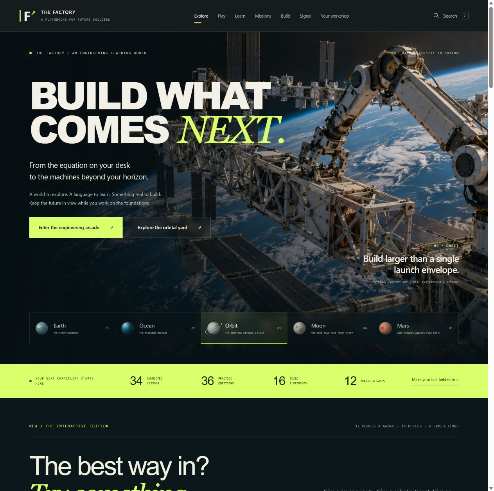

# The Factory That Builds the Future

An interactive engineering learning world that connects the math on a worksheet to the machines someone wants to build.

**[Explore the live website](https://ditchthescroll.com/factory)** · **[Read the engineering case study](docs/case-study.md)** · **[Work log](docs/work-log.md)** · **[Published launch film](https://x.com/VeryBullishGuy/status/2116037892246216830)**



## What you can do

- Explore **34 connected lessons**, **36 practice questions**, and five imagined engineering environments.
- Experiment with **12 models and games**: robot-arm reach, rover planning, lunar energy scheduling, feedback control, factory flow, thermal radiation, gears, and more.
- Follow **16 project blueprints** and **six guided expeditions**, with assumptions, checks, and evidence to keep.
- Watch **seven attributed industry talks** through explicitly loaded YouTube embeds.
- Read the **287-page field guide**, with **39 original diagrams** and **97 research entries**.
- Keep notes locally and export learning records. No account or backend is required.

These are bounded educational models, not validated industrial design tools. Speculative imagery is labeled as concept art.

## Run it locally

Requires Python 3 for the preview server and Node.js for validation. The website itself has no third-party runtime dependencies and needs no install step.

```sh
git clone https://github.com/christrovato2000-stack/factory-that-builds-the-future.git
cd factory-that-builds-the-future
python preview_public.py
```

Open **http://127.0.0.1:8777/factory/**. Use HTTP, rather than opening index.html directly, so ES modules and JSON loading work.

```sh
npm run check
```

The check runner validates **22 JavaScript modules and nine substantive suites**, including model calculations, energy accounting, rover solutions, inverse geometry, keyboard/lifecycle behavior, content references, and backup merging. No npm dependencies need to be installed.

## For reviewers and employers

Start with the [case study](docs/case-study.md), then inspect:

| Area | Evidence |
| --- | --- |
| Modeling and simulation | [Arcade models](public/arcade-models.js), [control sandbox](public/sandbox.js), [numerical tests](check_control.mjs) |
| Interactive product design | [Arcade UI](public/arcade.js), [guided expeditions](public/expeditions.js), [responsive styles](public/arcade.css) |
| Data handling | [Local backup merge logic](public/backup.js), [backup tests](check_backup.mjs) |
| Content architecture | [Learning catalog](public/learning-catalog.js), [project blueprints](public/project-blueprints.js), [source ledger](public/research.json) |
| Quality checks | [Validation entry point](check_all.mjs), [privacy and validation notes](docs/validation.md) |
| Communication | [Book manuscript](public-edition/work/Factory_Manuscript.md), [launch media](media/), [work log](docs/work-log.md) |

This project was developed with substantial Codex assistance across research, code, design, illustrations, testing, and media production. It is a learning and portfolio project; its presence here does not imply unaided authorship or mastery of every topic. The work log separates historical milestones from the date of the initial GitHub import.

## Repository map

```text
public/                 Deployable static website, book, and assets
public-edition/         Public book chapters, figures, research, builders, outputs
check_*.mjs             Nine validation suites and the common runner
docs/                   Case study, architecture, work log, screenshots, provenance
media/                  Launch films, posters, captions, and publication receipt
production/video/       Original animation and recut scripts
scripts/log-work.mjs    Append an honest, dated development-log entry
```

See [architecture and deployment](docs/architecture.md) for storage, route behavior, and the publishing boundary. Only `public/` is deployed; the live domain's other projects are not managed by this repository.

## Keep a useful development history

After doing meaningful work:

```sh
npm run check
npm run log -- "Describe what changed, why, and the evidence that it works"
git diff
git add -p
git commit -m "Describe the concrete improvement"
git push
```

Add new files explicitly when needed: `git add path/to/file`. The log helper does not commit or push on its own. There are no scheduled filler commits or fabricated contribution dates.

GitHub associates contributions with an account's commit email and eligible branches; see [GitHub's contribution reference](https://docs.github.com/en/account-and-profile/reference/profile-contributions-reference). A readable change and its evidence are more informative than a streak alone.

## Privacy and attribution

The repository contains the public edition. Private source conversations, personal educational plans, deployment credentials, session logs, and browser learning records are excluded. Third-party talks remain attributed external embeds. The published Thiel launch film contains archival PBS footage and a Carpenter Brut track; those third-party materials are not covered by a blanket reuse license. See [attribution and reuse](docs/attribution.md).
